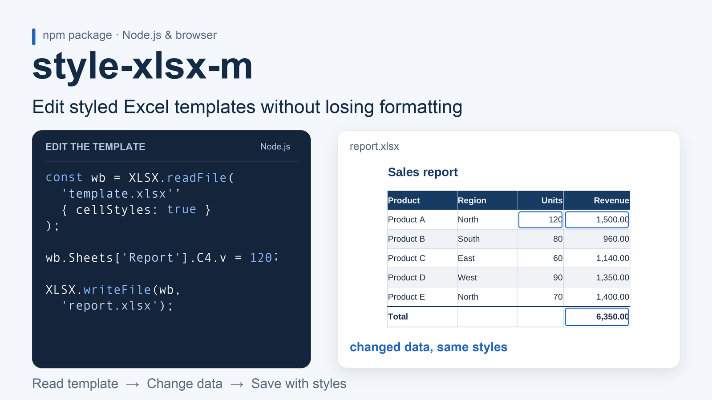
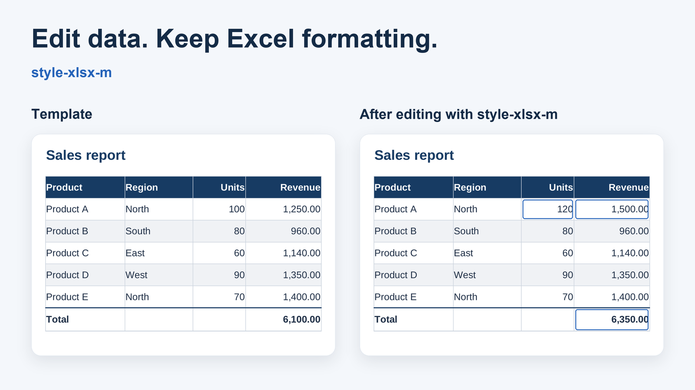

# style-xlsx-m

Read and write `.xlsx` files with selected cell styles in Node.js or bundled browser code, and set page setup for printing.



Based on [SheetJS Community Edition](https://github.com/SheetJS/sheetjs) (`xlsx` 0.18.5) and [xlsx-js-style](https://github.com/gitbrent/xlsx-js-style).

> **Security note:** this package is built on SheetJS 0.18.5, which has known vulnerabilities fixed upstream in later versions (prototype pollution, CVE-2023-30533, and ReDoS, CVE-2024-22363). **Do not use it to parse untrusted files.** `npm audit` will not flag this, because the SheetJS code is bundled into the package rather than installed as a dependency.

## Why this fork

| | SheetJS (npm `xlsx`) | xlsx-js-style | style-xlsx-m |
| :-- | :-- | :-- | :-- |
| Write cell styles | no | yes | yes |
| Read styles ready for styled writing | fill metadata only | fill metadata only | selected styles (`cellStyles: true`; see limitations) |
| `sheet_to_json` returns styles | no | no | yes (`getCellStyles: true`) |
| Page setup (`!pageSetup`) | no | no | yes |

The use case is editing a tested Excel template: read it, change the data, and save it with the supported formatting. Test your own templates before relying on a round trip.

## Installation

```sh
npm install style-xlsx-m
```

```sh
yarn add style-xlsx-m
```

## Quick start

```js
const XLSX = require('style-xlsx-m');

const wb = XLSX.utils.book_new();

const row = [
  { v: 'line\nbreak', t: 's', s: { alignment: { wrapText: true } } },
  { v: 'Courier: 24', t: 's', s: { font: { name: 'Courier', sz: 24 } } },
  { v: 'fill: color', t: 's', s: { fill: { patternType: 'solid', fgColor: { rgb: 'E9E9E9' } } } },
  { v: 'bold & color', t: 's', s: { font: { bold: true, color: { rgb: 'FF0000' } } } },
];

const ws = XLSX.utils.aoa_to_sheet([row]);
XLSX.utils.book_append_sheet(wb, ws, 'demo');
XLSX.writeFile(wb, 'demo.xlsx');
```

For everything else (`utils`, `read` options, other formats) see the [SheetJS documentation](https://docs.sheetjs.com/). It applies, except where this README says otherwise.

## Reading a file with styles

Pass `{ cellStyles: true }` to `readFile` (or `read`). Styled cells expose an `s` object for the writer. The independent openpyxl fixture confirms RGB solid fills, a theme-4 fill with tint, RGB/theme borders, font name/size/colour, bold/italic/single underline, and alignment. Number/date formats, merges, column widths, row heights, and A4 landscape page setup with scale 91 also survive that fixture. This is a partial round trip; see the limitations below.



The images are real LibreOffice renders of `.xlsx` files created with a locally packed build of this package. Blue outlines mark the three changed values. An independent openpyxl check confirmed that fonts, fills, borders and number formats stayed unchanged in this example.

```js
const XLSX = require('style-xlsx-m');

const wb = XLSX.readFile('./demo.xlsx', { cellStyles: true });
const ws = wb.Sheets['demo'];

ws.A1.v = 'changed'; // change the value; supported styles are written back
XLSX.writeFile(wb, 'demo-edited.xlsx');
```

Styles are also available per row from `sheet_to_json`:

```js
const { out, styles } = XLSX.utils.sheet_to_json(ws, { header: 1, getCellStyles: true });
// out[r][c]    -> cell value
// styles[r][i] -> style of the i-th visited cell ({} without a style)
```

Note: `styles[r]` lists the cells that `sheet_to_json` visits in that row, in order. It can be shorter than the sheet's width.

Reading styles works for `.xlsx` only, not `.xls`.

The `main` and `module` entries use the same style-reading build. In bundled browser code, use `import XLSX from 'style-xlsx-m'` and `XLSX.read(bytes, { type: 'array', cellStyles: true })` with a `Uint8Array` or `ArrayBuffer`. `readFile` requires the Node.js filesystem. Importing, editing and saving a styled template is tested with webpack for browser and Node.js targets. The corrected local build is also tested in React with Vite in development and production and real Chrome downloads; these corrections have not yet been published to npm.

```js
import XLSX from 'style-xlsx-m';

async function editTemplateInBrowser() {
  const response = await fetch('/Book1.xlsx');
  if (!response.ok) throw new Error(`Template request failed: ${response.status}`);
  const bytes = await response.arrayBuffer();
  const wb = XLSX.read(bytes, { type: 'array', cellStyles: true, cellNF: true });
  const ws = wb.Sheets[wb.SheetNames[0]];
  ws.B3.v = 'Edited in React';
  delete ws.B3.w; // discard the cached display text
  XLSX.writeFile(wb, 'Book1-edited.xlsx');
}
```

Call this function from a React button handler. Edit existing cell objects to keep their `s` style; recreating the sheet from values discards those styles. The parser and styled writer are shared with Node.js. Styled blank cells remain blank, and font `family`/`scheme` and theme-index-0 solid fills survive the tested local round trips.

## Cell styles reference

A cell is `{ v: value, t: type, s: style }`. The example below writes `alignment`, `border`, `fill` and `font`. Set the cell's `z` property for a number format.

```js
const COLOR = { rgb: 'FF0000' };          // hex value, no leading "#"
const COLOR_THEME = { theme: 4 };         // theme colour index
const COLOR_TINT = { theme: 1, tint: 0.4 };

const border = { style: 'thick', color: COLOR };

const style = {
  alignment: {
    vertical: 'center',      // 'top' | 'center' | 'bottom'
    horizontal: 'center',    // 'left' | 'center' | 'right'
    wrapText: true,
    textRotation: 0,         // 0 to 180, or 255 (vertical text)
  },
  border: {
    top: border,
    bottom: border,
    left: border,
    right: border,
    diagonal: { style: 'thin', color: COLOR },
    diagonalUp: false,
    diagonalDown: true,
  },
  font: {
    name: 'Calibri',
    sz: 11,                  // points
    family: 2,
    scheme: 'minor',
    color: COLOR,
    bold: false,
    italic: false,
    strike: false,
    underline: false,
    vertAlign: 'superscript', // 'superscript' | 'subscript'
  },
  fill: {
    patternType: 'solid',    // 'solid' | 'none'
    fgColor: COLOR,          // background colour of a solid fill
  },
};
```

Border `style` is one of: `dashDotDot`, `dashDot`, `dashed`, `dotted`, `hair`, `mediumDashDotDot`, `mediumDashDot`, `mediumDashed`, `medium`, `slantDashDot`, `thick`, `thin`.

## Page setup for printing

Set `!pageSetup` on a worksheet before writing:

```js
ws['!pageSetup'] = {
  paperSize: '9',          // '9' = A4
  scale: '91',             // percent
  fitToWidth: '0',         // '0' | '1'
  orientation: 'landscape' // 'landscape' | 'portrait'
};
```

When a file is **read**, `ws['!pageSetup']` is the raw `<pageSetup .../>` XML tag as a string, not an object. If you edit and re-save a file, assign an object as shown above to change the settings.

## Limitations / Known issues

- Based on SheetJS 0.18.5 (see the security note above). Do not parse untrusted files.
- Cell styles are read from `.xlsx` only, not `.xls`.
- Reading is a partial round trip. RGB and theme-4 solid fills with tint and a theme-index-0 fill are preserved in the tested local fixtures. These fixes are not yet in the published npm version 0.1.34.
- Excel Table objects and their table styles (for example, Table1 with striped rows in Book1.xlsx) are not preserved. This limitation applies in both Node.js and browsers; table styles are not cell `s` styles.
- An empty sheet returns `[]` even when `getCellStyles: true` is requested.
- Indexed border colours are exposed and saved as RGB. The tested indexed red keeps its RGB colour, but loses the indexed palette reference. Theme border colours keep their theme and tint. Custom theme palettes have not been tested.
- Single underline is confirmed. Other underline variants, gradient fills, conditional formatting, and diagonal border reading are not verified. Do not assume they are preserved.
- Number formats are preserved in the tested numeric and date cells, but are not part of `s`; use `cellNF: true` to expose them in `cell.z`. Merges, column widths and row heights are worksheet metadata (`!merges`, `!cols`, `!rows`), not cell styles.
- `!pageSetup` is returned as a raw XML string on read. The original A4/landscape/scale tag is preserved on save. To change it, assign the object shown above with string values. Numeric object values and other print settings are not verified.
- The TypeScript definitions are inherited from SheetJS with a `getCellStyles` option added. `s` and `!pageSetup` are not fully typed, and the `sheet_to_json` return types do not describe `{ out, styles }`.
- The `main` and `module` entries share the tested style reader. The separate CDN entries (`unpkg` and `jsdelivr`) remain upstream SheetJS builds and do not provide the same style-reading guarantees. The corrected local build is tested in React/Vite; Next.js applications have not been tested.
- Only these synchronous write functions are delegated to xlsx-js-style: `write`, `writeFile`, `writeFileSync`, `writeXLSX`, `writeFileXLSX`. `writeFileAsync` uses the inherited SheetJS writer and is outside these style guarantees.

## Credits & License

This package is a fork of [SheetJS Community Edition](https://github.com/SheetJS/sheetjs) and includes code from [xlsx-js-style](https://github.com/gitbrent/xlsx-js-style). Both are licensed under the Apache License 2.0.

Changes in this fork (by Shahrom Shukurov):
- Reading selected cell styles from existing `.xlsx` files (`cellStyles: true`)
- `getCellStyles` option for `sheet_to_json`
- Page setup for printing (paper size, orientation, scale)

This project is not affiliated with or endorsed by SheetJS LLC.
Licensed under the Apache License 2.0. See [LICENSE](https://github.com/MOR8T/style-xlsx-m/blob/main/LICENSE) and [NOTICE](https://github.com/MOR8T/style-xlsx-m/blob/main/NOTICE).
